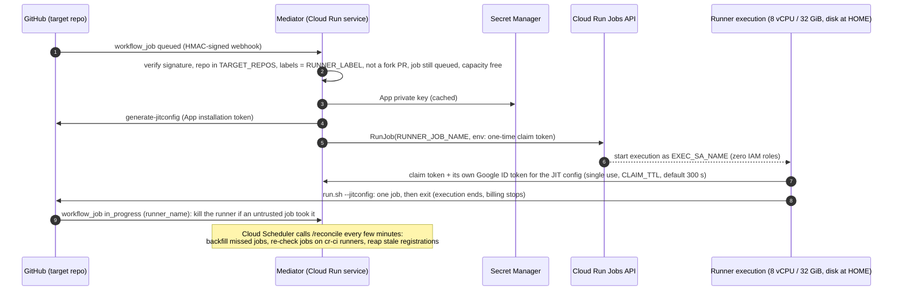

# cr-ci: GitHub Actions runners on Cloud Run Jobs

> **Status: implemented and tested offline; not yet deployed anywhere.** The
> mediator (P2), the runner image and entrypoint (P3), the GitHub setup guide,
> App manifest and workflow templates (P5) are done and tested offline. The
> deploy scripts (P4) are in progress. Nothing has run against real GitHub or
> GCP yet: that is the P6 PoC, which needs ptone's go-ahead. See
> [Phases](#phases).

cr-ci contains the documentation, scripts and code to run selected GitHub
Actions jobs of the scion repository on **ephemeral 8 vCPU / 32 GiB Cloud Run
Job executions**, started on demand by a small **mediator** Cloud Run service.

## Why

The `golangci-lint` job in `.github/workflows/ci.yml` is repeatedly OOM-killed
on GitHub-hosted `ubuntu-latest` runners (16 GB RAM). Compiling the `pkg/hub`
test package alone peaks at about 15 GB RSS. Cloud Run's largest GPU-less shape,
8 vCPU / 32 GiB, leaves about 16 GiB of headroom. It scales to zero and bills
per 100 ms. The full analysis and the alternatives considered are in the design:
[cr-runners design](https://storage.cloud.google.com/scion-xproject-exchange/cr-runners/design.md)
(`gs://scion-xproject-exchange/cr-runners/design.md`).

## Architecture



Jobs opt in through the `runs-on` expression, which reads the Actions variable
`SCION_LARGE_RUNNER`. Clearing that variable routes every job back to
`ubuntu-latest` immediately, with no commit (the
[fallback toggle](docs/architecture.md#fallback-toggle)). Everything is driven
by [`config.example.env`](config.example.env), so the same artifacts serve the
fork (`ptone/scion`), upstream (`GoogleCloudPlatform/scion`) or both. **Current
scope: `ptone/scion` only** (ptone, 2026-10-21); upstream needs a
GoogleCloudPlatform org owner and is future work
([permissions matrix](docs/permissions-matrix.md#0-summary-for-the-fork-vs-upstream-decision)).

## Quick start

Do the steps in this order. Each `scripts/*.sh` defaults to a dry run that
prints its `gcloud` or `gh` commands; add `--apply` to execute. The roles
each step needs are in [docs/permissions-matrix.md](docs/permissions-matrix.md).

1. **Config.** `cp config.example.env config.env` and fill in the REQUIRED
   keys. Until the App exists, use the placeholder `GITHUB_APP_ID=1`; every
   script validates the whole config, and the GCP-side ones ignore the value.
   `scripts/check-config.sh` validates the file and prints the resolved values.
2. **GCP bootstrap.** `scripts/bootstrap-gcp.sh`: APIs, service accounts,
   Artifact Registry, empty secrets, IAM ([gcp-setup.md](docs/gcp-setup.md)).
3. **Runner image.** `scripts/build-runner-image.sh`.
4. **Runner job.** `scripts/deploy-job.sh`.
5. **Mediator URL.** Compute the deterministic Cloud Run URL and set
   `MEDIATOR_URL` ([github-setup.md, step 1](docs/github-setup.md#1-fix-the-mediator-url)).
6. **GitHub App.** Create it from the manifest, and set `GITHUB_APP_ID`
   ([step 2](docs/github-setup.md#2-create-the-github-app-from-the-manifest-recommended);
   manual fallback in step 3). The App's **webhook URL is `MEDIATOR_URL/webhook`**,
   not the bare `MEDIATOR_URL`: deliveries to `/` get 404.
7. **Secrets.** `scripts/set-secrets.sh` with the App key and webhook secret
   from step 6 ([step 2.4](docs/github-setup.md#24-store-the-key-and-the-webhook-secret-in-secret-manager)).
8. **Mediator.** `scripts/deploy-mediator.sh`. It warns if the deployed URL
   differs from `MEDIATOR_URL`.
9. **Scheduler.** `scripts/deploy-scheduler.sh` (`/reconcile`).
10. **Install the App** on `ptone/scion` and check the webhook
    ([steps 4 and 5](docs/github-setup.md#4-install-the-app)). The current
    scope is the fork only; upstream would need a GoogleCloudPlatform org
    owner (future).
11. **Preconditions.** "Require approval for all external contributors" on
    the repository ([step 6](docs/github-setup.md#6-deploy-precondition-fork-pr-approval-g8);
    all preconditions in [architecture.md](docs/architecture.md#deploy-preconditions)).
12. **PoC.** Work through [docs/poc-checklist.md](docs/poc-checklist.md), which
    includes running [`workflows/cr-runner-poc.yml`](workflows/cr-runner-poc.yml)
    ([step 7](docs/github-setup.md#7-poc-run-before-any-routing); P6, needs
    ptone's go-ahead).
13. **Route.** `scripts/set-routing-variable.sh --repo <owner/repo> --apply`
    sets `SCION_LARGE_RUNNER`. It has no effect on CI until the routing expression
    is in the workflows (P7: the primary-runner workflow PRs). Fallback: `--clear --apply`
    ([step 8](docs/github-setup.md#8-route-jobs-the-actions-variable-scion_large_runner-g10)).

Two orderings matter. The App comes before the mediator, because the mediator
needs `GITHUB_APP_ID` to start while the App only needs the predictable
webhook URL. The PoC comes before the routing variable, so the path is
proven on a manually dispatched job before any CI job depends on it.

## Directory map

| Path | Contents |
| :--- | :--- |
| [`config.example.env`](config.example.env) | The single config contract (names only, never secret values) |
| [`mediator/`](mediator/) | Go Cloud Run service: `/webhook`, `/internal/claim`, `/reconcile`, `/health`; standard library only. Must run with `max-instances=1` |
| [`runner/`](runner/) | Runner image (`Dockerfile`, `entrypoint.sh`, offline harness); see [`runner/README.md`](runner/README.md) |
| [`runner/golangci-lint/`](runner/golangci-lint/) | The patched golangci-lint build (dominikh/go-tools#1839): pins, patch, `build.sh`. **Upstream `.github/workflows/ci.yml` and the root `Makefile` use it too**, so they depend on this cr-ci path; see below |
| [`scripts/`](scripts/) | Deploy, secret and teardown scripts (dry-run by default, `--apply` to execute), their test harness and golden transcripts; see [`scripts/README.md`](scripts/README.md) |
| [`workflows/`](workflows/) | Workflow templates, not active: the PoC workflow, with static checks (the live routing is in `.github/workflows`); see [`workflows/README.md`](workflows/README.md) |
| [`docs/architecture.md`](docs/architecture.md) | Flow, security model, failure modes, fallback |
| [`docs/permissions-matrix.md`](docs/permissions-matrix.md) | **Who needs which GitHub or GCP role for every step, fork vs upstream (future)**; the PAT alternative (not implemented) |
| [`docs/github-setup.md`](docs/github-setup.md) | GitHub App (manifest at [`scripts/github-app-manifest.json`](scripts/github-app-manifest.json)), installation on the fork (upstream: future), webhook check, fork-PR precondition, routing variable and fallback |
| [`docs/gcp-setup.md`](docs/gcp-setup.md) | GCP project, IAM, secrets, deploy (outline; P4) |
| [`docs/poc-checklist.md`](docs/poc-checklist.md) | Every runtime checkpoint for the P6 PoC (open U-items, runner checkpoints, cache sharing, success criteria) with commands and expected results |
| [`docs/operations.md`](docs/operations.md) | Rollout, fallback, rotation, quotas, troubleshooting (outline) |

## A repository-wide dependency on cr-ci

[`runner/golangci-lint/`](runner/golangci-lint/README.md) is the single copy of
the interim golangci-lint build with the go-tools#1839 patch. Three users run
its `build.sh`: the `lint` job of `.github/workflows/ci.yml` (on GitHub-hosted
runners and the cr-ci runner alike), `make golangci-lint`, and the runner image
([`runner/Dockerfile`](runner/Dockerfile)). So upstream CI **depends on a
`cr-ci/` path**: moving, renaming or deleting that directory breaks the lint
job, and a change there re-runs it (the `changes` job's regex covers it). Its
README has the removal plan for when a golangci-lint release ships the fix.

## Go module

`cr-ci/` is its own Go module (`github.com/GoogleCloudPlatform/scion/cr-ci`,
Go 1.26.1), like `extras/*`. It does not import the scion product packages, and
the root module's `./...` does not include it. From `cr-ci/`:

```bash
go build -o /dev/null ./... && go vet ./... && go test ./... && gofmt -l .
```

## Phases

| Phase | Scope | State |
| :--- | :--- | :--- |
| P1 | Skeleton, config contract, docs outline, complete permissions matrix | done |
| P2 | Mediator: HMAC, fork guard, idempotency, JIT, RunJob, claim endpoint, `/reconcile`, backpressure | implemented (in review) |
| P3 | Runner image and entrypoint (work folder and caches on the disk at HOME, claim exchange) | implemented (in review) |
| P4 | Idempotent deploy and teardown scripts with `--dry-run` | implemented (in review) |
| P5 | GitHub setup guide, App manifest, workflow templates | implemented (in review) |
| P6 | Live PoC on the chosen target (needs ptone's go-ahead); [checklist](docs/poc-checklist.md) | gated |
| P7 | Routing in `.github/workflows` (primary-runner PR-wf1 phase A, PR-wf2 phase B; separate PRs, outside `cr-ci/`) | in review |

Nothing in this directory touches live GitHub or GCP resources. Running the
scripts against real resources is a separate step that needs explicit approval
(P6).
