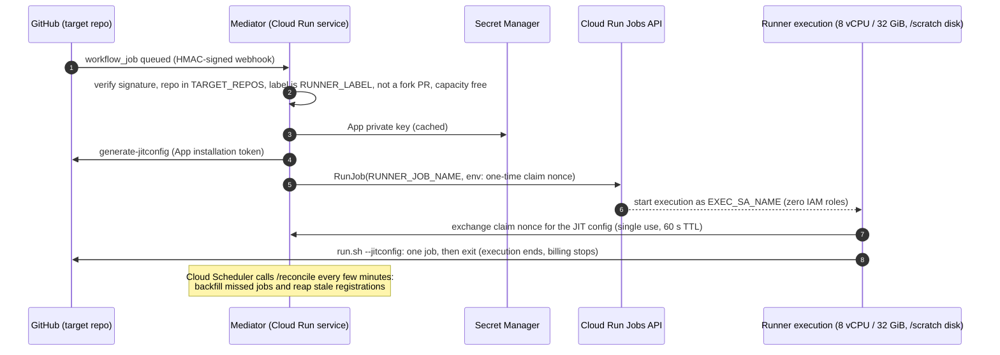

# cr-ci: GitHub Actions runners on Cloud Run Jobs

> **Status: P1 skeleton. Not deployable yet.** The config contract, the
> permissions matrix and the doc structure exist. The mediator is a stub that
> validates config and serves `/health`; the runner image and entrypoint are
> implemented (P3, in review); the scripts are placeholders. See [Phases](#phases).

cr-ci contains the documentation, scripts and code to run selected GitHub
Actions jobs of the scion repository on **ephemeral 8 vCPU / 32 GiB Cloud Run
Job executions**, started on demand by a small **mediator** Cloud Run service.

## Why

The `golangci-lint` job in `.github/workflows/ci.yml` is repeatedly OOM-killed
on GitHub-hosted `ubuntu-latest` runners (16 GB RAM). Compiling the `pkg/hub`
test package alone peaks at about 15 GB RSS. Cloud Run's largest GPU-less shape,
8 vCPU / 32 GiB, leaves about 16 GiB of headroom. It scales to zero and bills
per 100 ms. The full analysis and the alternatives considered are in the design:
[cr-runners design](https://storage.cloud.google.com/scion-xproject-exchange/cr-runners/design.md)
(`gs://scion-xproject-exchange/cr-runners/design.md`).

## Architecture



Jobs opt in through the `runs-on` expression, which reads the Actions variable
`SCION_LARGE_RUNNER`. Clearing that variable routes every job back to
`ubuntu-latest` immediately, with no commit (the
[fallback toggle](docs/architecture.md#fallback-toggle)). Everything is driven
by [`config.example.env`](config.example.env), so the same artifacts serve the
fork (`ptone/scion`), upstream (`GoogleCloudPlatform/scion`) or both.

## Directory map

| Path | Contents |
| :--- | :--- |
| [`config.example.env`](config.example.env) | The single config contract (names only, never secret values) |
| [`mediator/`](mediator/) | Go Cloud Run service. P1: config loader + tests, `/health` stub |
| [`runner/`](runner/) | Runner image (`Dockerfile`, `entrypoint.sh`, offline harness); see [`runner/README.md`](runner/README.md) |
| [`scripts/`](scripts/) | Deploy and teardown scripts (P4). P1: planned list and the `--dry-run` contract |
| [`workflows/`](workflows/) | Workflow templates, not active (P5). P1: README |
| [`docs/architecture.md`](docs/architecture.md) | Flow, security model, failure modes, fallback |
| [`docs/permissions-matrix.md`](docs/permissions-matrix.md) | **Who needs which GitHub or GCP role for every step, fork vs upstream** |
| [`docs/github-setup.md`](docs/github-setup.md) | GitHub App, installation, settings (outline; P5) |
| [`docs/gcp-setup.md`](docs/gcp-setup.md) | GCP project, IAM, secrets, deploy (outline; P4) |
| [`docs/operations.md`](docs/operations.md) | Rollout, fallback, rotation, quotas, troubleshooting (outline) |

## Go module

`cr-ci/` is its own Go module (`github.com/GoogleCloudPlatform/scion/cr-ci`,
Go 1.26.1), like `extras/*`. It does not import the scion product packages, and
the root module's `./...` does not include it. From `cr-ci/`:

```bash
go build -o /dev/null ./... && go vet ./... && go test ./... && gofmt -l .
```

## Phases

| Phase | Scope | State |
| :--- | :--- | :--- |
| P1 | Skeleton, config contract, docs outline, complete permissions matrix | **this change** |
| P2 | Mediator: HMAC, fork guard, idempotency, JIT, RunJob, claim endpoint, `/reconcile`, backpressure | planned |
| P3 | Runner image and entrypoint (`/scratch` redirection, claim exchange) | implemented (in review) |
| P4 | Idempotent deploy and teardown scripts with `--dry-run` | planned |
| P5 | GitHub setup guide, App manifest, workflow templates | planned |
| P6 | Live PoC on the chosen target (needs ptone's go-ahead) | gated |
| P7 | `ci.yml` `runs-on` change (separate PR, outside `cr-ci/`) | gated |

Nothing in this directory touches live GitHub or GCP resources. Running the
scripts against real resources is a separate step that needs explicit approval
(P6).
